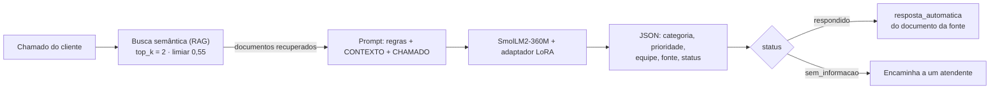
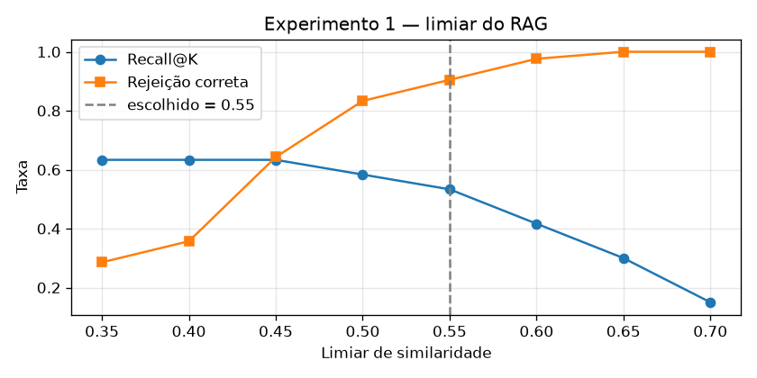
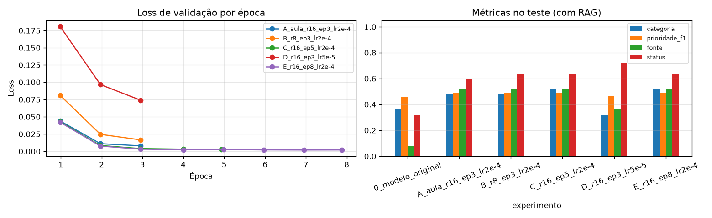
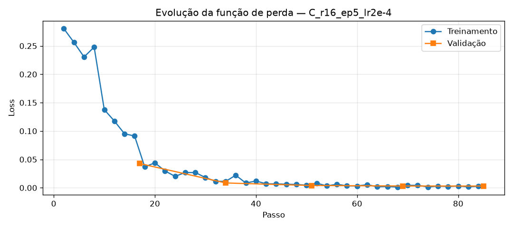

# 🛒 Assistente de atendimento de e-commerce com SmolLM2-360M, RAG e LoRA

**CP2/CP3 — Generative AI for Engineering** · FIAP · Turma 4ESR-2026 · Prof. Francisco Elânio

Uma LLM pequena (**SmolLM2-360M-Instruct**), ajustada com **LoRA** em uma GPU local e combinada com **RAG**, que lê o chamado de um cliente, consulta as políticas da loja, classifica o atendimento (categoria, prioridade e equipe) e devolve uma **resposta automática** ao cliente. Quando a base não cobre o assunto, o chamado é encaminhado a um atendente, sem inventar resposta.

---

## 👥 Integrantes

| Nome | RM |
|---|---|
| _(nome)_ | _(RM)_ |
| _(nome)_ | _(RM)_ |
| _(nome)_ | _(RM)_ |
| _(nome)_ | _(RM)_ |
| _(nome)_ | _(RM)_ |

---

## 📌 Sumário

1. [Problema](#-problema)
2. [Solução](#-solução)
3. [Estrutura do repositório](#-estrutura-do-repositório)
4. [Como abrir o app](#-como-abrir-o-app)
5. [Base de conhecimento](#-base-de-conhecimento)
6. [Experimentos e resultados](#-experimentos-e-resultados)
7. [Análise dos erros](#-análise-dos-erros)
8. [Evolução: versão 1 → versão 2](#-evolução-versão-1--versão-2)
9. [GPU e prints](#-gpu-e-prints)

---

## 🎯 Problema

Uma loja virtual fictícia recebe chamados de clientes escritos em português, sobre 20 assuntos: entrega, defeito, troca, reembolso, cancelamento, pagamento, fraude, nota fiscal, garantia, acesso à conta, privacidade, vale-presente e outros.

O objetivo é treinar **localmente, em GPU,** uma LLM pequena para:

1. receber o chamado do cliente;
2. consultar a base de políticas da loja (**RAG**);
3. classificar **categoria** e **prioridade** e indicar a **equipe** responsável;
4. devolver um **JSON** com o procedimento e a **fonte** (documento) usada;
5. responder `sem_informacao` quando a base não cobre a pergunta, em vez de inventar.

---

## 💡 Solução

> **O fine-tuning ensina _como_ responder; o RAG fornece _o conhecimento_ usado na resposta.**

| Componente | Escolha | Papel |
|---|---|---|
| LLM | [`HuggingFaceTB/SmolLM2-360M-Instruct`](https://huggingface.co/HuggingFaceTB/SmolLM2-360M-Instruct) | Lê o contexto e gera o JSON |
| Fine-tuning | LoRA (PEFT), r=16, 5 épocas | Ensina o formato JSON, os rótulos válidos e a recusar quando não sabe. Treina só **8,7 M de parâmetros (2,3 %)** |
| Embeddings (RAG) | [`paraphrase-multilingual-MiniLM-L12-v2`](https://huggingface.co/sentence-transformers/paraphrase-multilingual-MiniLM-L12-v2) | Busca por significado na base de políticas |
| Base de conhecimento | 20 políticas fictícias (`base_conhecimento.py`) | Fonte das respostas |
| Frontend | Streamlit (`app_streamlit.py`) | Chat de atendimento |

### Fluxo de um chamado



**Exemplo:** *"A transação foi negada no checkout."*

1. A busca encontra o **DOC-006 (Pagamento recusado)**.
2. O modelo gera:
   ```json
   {"categoria": "pagamento", "prioridade": "alta", "equipe": "financeiro", "procedimento": "...", "fonte": "DOC-006", "status": "respondido"}
   ```
3. O cliente recebe a `resposta_automatica` do DOC-006: *"Olá! Pagamentos recusados geralmente acontecem por algum dado incorreto ou limite insuficiente no cartão..."*

O modelo **não escreve** a mensagem ao cliente: ele classifica o chamado e aponta a fonte, e o sistema envia o texto revisado pela empresa. Assim o modelo não tem como inventar prazos ou políticas na conversa.

### Detalhes do pipeline

- **RAG com exemplos indexados:** cada documento é representado pelo seu texto e por 4 perguntas típicas de clientes. A nota do documento é a maior similaridade entre o chamado e esses textos.
- **Contexto com metadados:** cada documento entregue ao modelo traz categoria, prioridade, equipe e procedimento, então o modelo só precisa copiar do documento certo.
- **Treino com distrator:** parte dos exemplos traz 2 documentos no contexto (o certo e um errado), como acontece na busca real com `top_k = 2`.
- **Exemplos negativos:** perguntas fora da base, com contexto vazio ou com um documento irrelevante, ensinam a responder `sem_informacao`.
- **Validação da saída:** se a `fonte` não for o ID de um documento da base, ela vira `null`.

---

## 📁 Estrutura do repositório

```
├── CP_Ecommerce_SmolLM2_RAG_LoRA_v2.ipynb   # notebook principal (treino, experimentos e avaliação)
├── CP_Ecommerce_SmolLM2_RAG_LoRA.ipynb      # versão 1 (histórico, 8 documentos)
├── app_streamlit.py                         # frontend (chat de atendimento)
├── base_conhecimento.py                     # 20 políticas da loja + respostas automáticas
├── chamados_exemplo.py                      # frases de treino, perguntas fora da base e casos de teste
├── requirements.txt                         # dependências do app Streamlit
├── .streamlit/config.toml                   # configuração do Streamlit
├── saidas_v2/                               # resultados da versão 2
│   ├── adaptadores/C_r16_ep5_lr2e-4/        # adaptador LoRA do melhor experimento (usado pelo app)
│   ├── config_final.json                    # modelo escolhido, limiar e métricas
│   ├── resultados_experimentos.csv
│   ├── avaliacao_*.csv                      # respostas caso a caso de cada experimento
│   └── *.png                                # gráficos
├── saidas/                                  # resultados da versão 1
└── prints/                                  # prints da GPU e do app
```

---

## 🚀 Como abrir o app

O app usa o modelo **já treinado**: o adaptador LoRA do melhor experimento está em `saidas_v2/adaptadores/C_r16_ep5_lr2e-4/`, e não é preciso rodar o notebook.

**Pré-requisito:** Python 3.12.

No terminal (PowerShell), na pasta do repositório:

```powershell
# 1. Criar e ativar um ambiente virtual
py -3.12 -m venv .venv
.venv\Scripts\Activate.ps1

# 2. Instalar as dependências do app
python -m pip install -r requirements.txt

# 3. Abrir o app
streamlit run app_streamlit.py
```

Depois, abra <http://localhost:8501> no navegador.

- Na **primeira execução**, o app baixa do Hugging Face o modelo base (SmolLM2-360M) e o de embeddings, cerca de 1 GB, e guarda tudo na pasta `hf-cache/`. As execuções seguintes já abrem com os modelos em cache.
- Roda na CPU, sem precisar de GPU. Cada resposta pode levar alguns segundos.
- Se o PowerShell bloquear o `Activate.ps1`, rode antes: `Set-ExecutionPolicy -Scope Process -ExecutionPolicy RemoteSigned`.
- Para encerrar o app, aperte **Ctrl+C** no terminal.

---

## 📚 Base de conhecimento

20 políticas de uma loja **fictícia**, em `base_conhecimento.py`. Cada documento tem `conteudo` (o que o RAG busca), o gabarito (`categoria`, `prioridade`, `equipe`, `procedimento`) e a `resposta_automatica` enviada ao cliente.

| ID | Título | Categoria | Prioridade | Equipe |
|---|---|---|---|---|
| DOC-001 | Atraso na entrega | `entrega` | media | `logistica` |
| DOC-002 | Produto com defeito ou danificado | `defeito` | alta | `trocas_devolucoes` |
| DOC-003 | Troca por arrependimento, tamanho ou cor | `troca` | baixa | `trocas_devolucoes` |
| DOC-004 | Prazo de reembolso | `reembolso` | media | `financeiro` |
| DOC-005 | Cancelamento de pedido | `cancelamento` | media | `atendimento` |
| DOC-006 | Pagamento recusado | `pagamento` | alta | `financeiro` |
| DOC-007 | Cupom de desconto inválido | `cupom` | baixa | `marketing` |
| DOC-008 | Compra não reconhecida ou suspeita de fraude | `fraude` | critica | `seguranca` |
| DOC-009 | Alteração do endereço de entrega | `endereco` | media | `logistica` |
| DOC-010 | Valor do frete e frete grátis | `frete` | baixa | `atendimento` |
| DOC-011 | Produto errado ou faltando no pedido | `pedido_incorreto` | alta | `logistica` |
| DOC-012 | Nota fiscal | `nota_fiscal` | baixa | `financeiro` |
| DOC-013 | Garantia do fabricante | `garantia` | media | `trocas_devolucoes` |
| DOC-014 | Parcelamento e formas de pagamento | `parcelamento` | baixa | `financeiro` |
| DOC-015 | Acesso à conta e senha esquecida | `conta` | media | `suporte_tecnico` |
| DOC-016 | Exclusão de conta e dados pessoais | `privacidade` | media | `privacidade` |
| DOC-017 | Programa de pontos | `fidelidade` | baixa | `marketing` |
| DOC-018 | Produto esgotado e aviso de disponibilidade | `estoque` | baixa | `comercial` |
| DOC-019 | Problema no site ou no aplicativo | `site_app` | alta | `suporte_tecnico` |
| DOC-020 | Vale-presente | `vale_presente` | baixa | `financeiro` |

**Dados de treino e teste** (`chamados_exemplo.py`):

- 5 frases por documento: 4 vão para o treino e para o índice do RAG, e a 5ª fica só para a validação;
- 14 perguntas fora da base (exemplos negativos);
- cada frase é combinada com 3 aberturas, o que dá **276 exemplos de treino e 66 de validação**;
- **25 casos de teste inéditos** (1 por documento e 5 fora da base), usados só na avaliação final.

---

## 🧪 Experimentos e resultados

Todos os números abaixo são da **versão 2** (20 documentos), medidos nos 25 casos de teste inéditos.

### Experimento 1 — limiar do RAG

O limiar é a nota mínima de similaridade para um documento entrar no contexto. Ele foi escolhido com frases de validação, sem usar o conjunto de teste.

| Limiar | Recall@2 (achou o documento certo) | Rejeição correta (fora da base) | Média |
|---|---|---|---|
| 0,35 | 63,3 % | 28,6 % | 46,0 % |
| 0,40 | 63,3 % | 35,7 % | 49,5 % |
| 0,45 | 63,3 % | 64,3 % | 63,8 % |
| 0,50 | 58,3 % | 83,3 % | 70,8 % |
| **0,55** | **53,3 %** | **90,5 %** | **71,9 %** ✅ |
| 0,60 | 41,7 % | 97,6 % | 69,6 % |
| 0,65 | 30,0 % | 100 % | 65,0 % |
| 0,70 | 15,0 % | 100 % | 57,5 % |

Limiar baixo traz documentos para perguntas que não têm resposta. Limiar alto deixa de trazer o documento certo. O valor **0,55** dá o melhor equilíbrio.



### Experimento 2 — fine-tuning com LoRA

| Exp. | r | Épocas | Learning rate | Loss de validação | Tempo de treino | JSON válido | Categoria | Prioridade (F1) | Fonte | Status | **Pontuação** |
|---|---|---|---|---|---|---|---|---|---|---|---|
| Modelo original (sem treino) | — | — | — | — | — | 76 % | 36 % | 46,0 % | 8 % | 32 % | **30,5 %** |
| A (config. da aula) | 16 | 3 | 2e-4 | 0,008 | 6,9 min | 100 % | 48 % | 48,6 % | 52 % | 60 % | **52,1 %** |
| B (rank menor) | 8 | 3 | 2e-4 | 0,017 | 6,7 min | 100 % | 48 % | 49,2 % | 52 % | 64 % | **53,3 %** |
| **C (mais épocas)** ✅ | 16 | 5 | 2e-4 | 0,003 | 11,5 min | 100 % | 52 % | 49,2 % | 52 % | 64 % | **54,3 %** |
| D (lr menor) | 16 | 3 | 5e-5 | 0,074 | 6,4 min | 92 % | 32 % | 46,7 % | 36 % | 72 % | **46,7 %** |
| E (8 épocas) | 16 | 8 | 2e-4 | 0,002 | 18,0 min | 100 % | 52 % | 49,2 % | 52 % | 64 % | **54,3 %** |

*Todos com RAG. A pontuação é a média de categoria, prioridade (F1), fonte e status. O C foi escolhido em vez do E pelo empate na pontuação com menos tempo de treino. Pico de memória na GPU: ~3,5 GB.*

**Conclusões do Experimento 2:**

- **O treino funciona:** a pontuação foi de **30,5 % para 54,3 %**, e o JSON válido chegou a **100 %**.
- **Learning rate baixo (D) aprende pouco:** a loss fica alta (0,074) e o modelo ainda gera JSON inválido.
- **r=8 (B) é quase tão bom quanto r=16** com metade dos parâmetros treináveis (4,3 M contra 8,7 M).
- **Depois de 5 épocas não há ganho (C = E):** o limite passa a estar na busca, não no modelo (veja a [análise dos erros](#-análise-dos-erros)).
- **O RAG é essencial:** o mesmo modelo C **sem RAG** fica com **19,3 %** de pontuação, contra **54,3 %** com RAG.





---

## 🔍 Análise dos erros

Olhando os 25 casos de teste um a um (`saidas_v2/avaliacao_modelo_final.csv`):

```
20 chamados com resposta na base
├── a busca trouxe o documento certo → 10 casos → o modelo acertou 9 ✅ (90 %)
├── a busca não trouxe nada          →  8 casos → o modelo respondeu "sem_informacao"
└── a busca trouxe documentos errados →  2 casos → o modelo escolheu entre os errados

5 chamados fora da base → 4 recusados corretamente
```

**O gargalo é a busca, não o modelo.** Quando recebe o documento certo, o modelo acerta 9 em cada 10 casos, e a "fonte fundamentada" foi de 100 % (ele nunca cita um documento que a busca não trouxe). Os erros vêm de chamados escritos com palavras diferentes das usadas na base:

| Chamado | O que a busca trouxe | Resultado |
|---|---|---|
| "A tela do notebook veio trincada." | nada (deveria ser DOC-002, defeito) | encaminhado a um atendente |
| "O app não abre desde a última atualização." | nada (deveria ser DOC-019, site/app) | encaminhado a um atendente |
| "Comprando R$ 250 eu pago entrega?" | DOC-020 e DOC-014 (deveria ser DOC-010, frete) | classificado como parcelamento |
| "Quem é o dono da empresa?" | DOC-013 (deveria ser nenhum) | classificado como garantia |

Por isso os experimentos de treino A, B, C e E ficaram próximos (52 % a 54 %): mudar o modelo não resolve um erro que acontece antes dele.

---

## 🔄 Evolução: versão 1 → versão 2

| | Versão 1 | Versão 2 |
|---|---|---|
| Base de conhecimento | 8 documentos | 20 documentos |
| Casos de teste | 12 | 25 |
| Pontuação (antes → depois do treino) | 13,8 % → 48,2 % | 30,5 % → 54,3 % |
| Fonte fundamentada | 41,7 % | 100 % |

A análise da v1 mostrou três problemas, corrigidos na v2:

| Problema na v1 | Evidência | Correção na v2 |
|---|---|---|
| A busca não achava o documento certo | 3 dos 8 chamados de teste ficaram com contexto vazio | **Exemplos indexados** no RAG |
| Categoria, prioridade e equipe eram "chutadas" | A equipe saía sempre `financeiro`: esses campos não estavam no contexto | **Contexto com metadados** de cada documento |
| `fonte` com texto em vez de `null` | O modelo escrevia "Nenhum documento..." no campo | **Validação da saída** |

Os resultados da v1 estão em `saidas/` e o notebook em `CP_Ecommerce_SmolLM2_RAG_LoRA.ipynb`.

---

## 📸 GPU e prints

Treino feito localmente no VSCode:

| | |
|---|---|
| GPU | NVIDIA GeForce RTX 3050 6 GB Laptop (compute capability 8.6) |
| PyTorch | 2.14.1 + CUDA 12.6 |
| Precisão | bfloat16 |

**GPU no VSCode (extensões GPU Environment / GPU Monitor):**


**GPU em uso durante o treino:**


**App Streamlit:**


